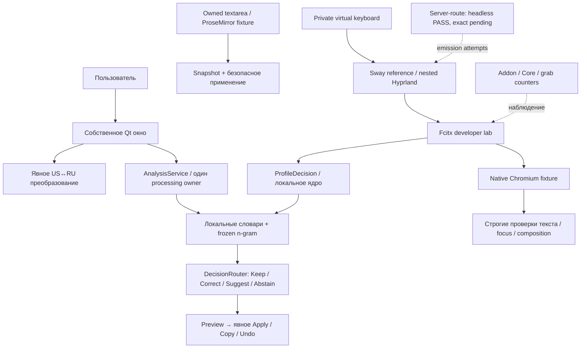

# Карта проекта rasklad

Снимок навигации: 2026-11-15. Это компактная карта собственного проекта,
не полный call graph и не обещание поддержки всех приложений.
Машинная версия: [project-map.json](project-map.json).
Сначала прочитайте применимые `AGENTS.md`; затем выберите строку задачи ниже.
Не загружайте весь `build/`, историю экспериментов или соседние проекты.

## Архитектура и границы



Сплошные стрелки — отношения реализации/тестового пути, проверенные по исходникам.
Пунктир — диагностика, не исправление. Диаграмма не утверждает атомарность
между процессами или подтверждённую доставку протокольного события.

## Что означает «двухэтапное ядро»

1. Полные локальные морфологические словари проверяют исходное и преобразованное
   слово; ambiguity guards учитывают full/control Hunspell и stem indices.
2. Замороженная квантованная n-gram модель подтверждает подходящего кандидата.
   Это сравнительные scores, не вероятность и не новая нейросеть.

`safeConfirmed` сохраняет известное исходное слово. При расхождении/неизвестности
автоматическое решение может быть Abstain; Suggest не применяется автоматически.
Контекст прошлых слов и online learning не являются обязательными этапами.
Точная политика: `docs/ADR-001-DETECTOR-ROUTING.md` и `src/decisionrouter.cpp`.
Явный ручной converter не обязан угадывать намерение через этот pipeline.
Распознавание слова не даёт права изменять поле другого приложения.

## Задача → минимальный набор чтения

| Задача | Прочитать сначала (2–4 файла) |
| --- | --- |
| Исправить US/RU mapping | `src/layoutconverter.h`, `src/layoutconverter.cpp`, `tests/rasklad_tests.cpp` |
| Изменить решение ядра | `docs/ADR-001-DETECTOR-ROUTING.md`, `src/decisionrouter.h`, `src/decisionrouter.cpp` |
| Проверить словари/модель | `src/localprofile.h`, `src/localprofile.cpp`, `src/profileverify.cpp`, `THIRD_PARTY.md` |
| Изменить Qt preview | `src/documentcontroller.cpp`, `src/analysisservice.cpp`, `src/Main.qml` |
| Browser input/revision | `browser/README.md`, `browser/adapter.js`, `browser/session.js`, `browser/prosemirror.js` |
| Fcitx composition/commit | `src/fcitxlab.cpp`, `src/fcitxlabprofile.cpp`, `docs/FCITX-TRANSPORT-001.md` |
| Focus regression | `tests/chromium_ime/adversarial-focus.mjs`, `tests/chromium_ime/driver.mjs`, `docs/HYPRLAND-FOCUS-STRESS-001.md` |
| Missing Space /008 | `docs/GRAB-ENTRY-WITNESS-001.md`, `docs/SERVER-ROUTE-WITNESS-001.md`, `tests/chromium_ime/addon-witness.mjs` |
| Диагностика маршрута server | `docs/SERVER-ROUTE-WITNESS-001.md`, `tools/server_route_witness_guard.py`, `tests/chromium_ime/server-route-witness.mjs` |
| Разрешения exact trial | `tools/hyprland_ime_lab.py`, `docs/HYPRLAND-IME-001.md`, `SECURITY.md` |
| Лицензии/новый язык | `LICENSE`, `THIRD_PARTY.md`, `docs/DATA_POLICY.md` |
| Поддержка нового приложения | `docs/APPLICATION-POLICY.md`, `docs/ADR-001-input-boundary.md`, `browser/README.md` |

## Реальный статус адаптеров

- Qt: собственное окно и явные preview/Apply/Copy/Undo.
- Browser: реализованы owned-field/ProseMirror механизмы и fixtures;
  это не установленное расширение для произвольной почты/мессенджера.
- Fcitx: developer-only composition transport и отдельный full-core profile;
  это не готовое глобальное подключение рабочего desktop.
- Slack desktop: поддержка безопасного редактирования не доказана.
- Terminal: универсальное исправление произвольной командной строки не доказано.
- Per-app выключатели: контракт opt-in; новая поддержка по умолчанию выключена.

## Текущий узкий вопрос:008

Исторический результат008: пять коррелированных повторов case2
`word → other → prose → Space` завершились FAIL; исходное слово сохранено,
пробел отсутствует. Остальные focus-кейсы, baseline и cleanup прошли.
На grab/Core/addon наблюдались totals6/7 и Space0/1; coverage полная,
unknown states0, saturation отсутствует. Это отсутствие press в наблюдённых
callback-интервалах, не доказанная причина внутри Hyprland.
Повторы одного сеанса не дают IID оценку частоты ошибки.

Следующий server-route witness должен различить incoming private VK requests
и server emission attempts. Он учитывает ВСЕ private VK, включая forwarding;
`wl_keyboard` может дублироваться по ресурсам. Emission не равен доставке.
На момент этой карты preflight pending; разрешения прошлых host-проб использованы.
Сначала закрытая проверка, затем отдельное разрешение на следующую exact пробу.
Не считать подготовленный shim, passing mock или согласие моделей исправлением.

## Проверки и их зависимости

Команды ниже — навигация, а не отчёт об их новом запуске.

```sh
bin/build
bin/test -silent
node tests/browser/adapter.test.mjs
node tests/browser/router.test.mjs
node --test tests/wayland_ime/addon_witness_tests.mjs
node --test tests/wayland_ime/space_telemetry_tests.mjs
node --test tests/wayland_ime/server_route_witness_tests.mjs
```

Qt-тестам нужны установленный Qt/qmake6/compiler; Hunspell-зависимые наборы
зависят от доступности библиотеки. Mock tests проверяют guards/oracles,
но не доказывают доставку ввода настоящим compositor.
Browser fixture требует предварительно `bin/build-browser-fixture`;
`node tests/browser/run.mjs` запускает отдельный изолированный Chromium fixture.
Wayland reference: `bin/test-wayland-ime` — сначала прочитайте CLI/runner,
план без запуска не равен успешному испытанию. Exact: `bin/test-hyprland-ime` —
никакого самостоятельного перехода к `--run-approved` по этой карте.

## Безопасность и лицензии

Обычная сборка отделена от diagnostic variants. Preload допустим только
в выделенном дочернем процессе private lab, не в global environment.
Reference не получает host display/GPU. Exact получает только согласованные
parent Wayland/render ресурсы; настройки host, Slack и рабочий IME не меняются.
Unknown/protected поля не заменяются догадками по заголовку окна.
CDP наблюдает собственный fixture; private VK вводит фиксированный synthetic input.
Нет основания читать пользовательскую переписку, clipboard или другие проекты.

Собственный код MIT; словари, модельные assets, библиотеки и notices проверяются
отдельно. Локальность данных не отменяет лицензионные обязательства.
Не копировать чужую реализацию только потому, что её исходники публичны.

## Как поддерживать карту

JSON содержит стабильные domain IDs, относительные paths, тестовые команды,
статусы и evidence paths. `confidence: explicit` означает явную связь исходников
или документов; это не свежий runtime PASS. `inferred` требует явной оговорки.
Смена архитектуры/адаптера/диагностического статуса требует обновить обе карты.
Исторические результаты не заменять текущими предположениями; устаревшие
статусы уточнять по исходникам и последнему узкому отчёту, не по всей build-истории.

## Короткие запросы и Obsidian

`bin/project-map find fcitx` — компоненты, исходники и нужные проверки;
`bin/project-map file tools/hyprland_ime_lab.py` — определения и явные ссылки;
`bin/project-map check` — актуальность индекса; `build` — обновление.
Детали и проверенные ограничения Graphify: [NAVIGATION-TOOLS.md](NAVIGATION-TOOLS.md).
Папку `docs/knowledge` можно открыть отдельно как Obsidian vault с `Start.md`.
Навигация локальная; фоновых процессов, sync и cloud extraction нет.
